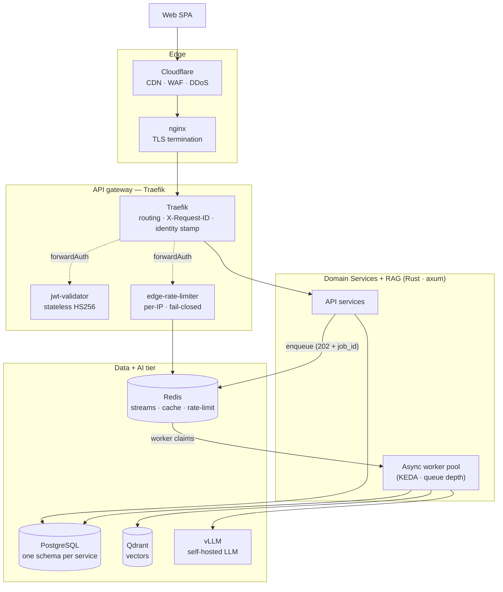

# Saturn — Architecture Case Study

**Saturn** is the full stack platform I designed and built: a **multi-tenant AI education platform** where users subscribe to courses and content collections and work through them with an **AI assistant** that answers questions over that content using **retrieval-augmented generation (RAG)**. I built and run it myself; it is **self-hosted** on a single-node Kubernetes cluster and stays up continuously.

This repository is a **case study**, not the code. It documents _how_ the system is structured, _why_ the key decisions were made, and _how I worked_ — built almost entirely with **agentic coding (Claude Code)** — so a reader can verify the shape and rigor of the work without me publishing the implementation.

> **Why a docs-only repo?** The product and its code are private. What I _can_ share, and what I'm proudest of, is the architecture and the engineering discipline around it. Everything here is real and as-built; where I generalize (e.g. business details, host names, exact commit IDs) it's marked or obvious, and the patterns are the point.

---

## At a glance

|||
|---|---|
|**What**|Multi-tenant AI education platform: Rust backend services + React frontend, with a RAG-powered assistant over ingested course content|
|**Backend**|Rust (axum, sqlx, tokio, tonic)|
|**Frontend**|React 18 + Vite SPA · 200+ frontend tests · Playwright E2E|
|**Style**|8 domain microservices + 2 gateway-side services, behind an API gateway|
|**How it got here**|Migrated off a ~1,400-line FastAPI monolith to Rust services, **one at a time** (strangler-fig)|
|**Data**|PostgreSQL (one schema per service, least-priv roles) · Redis (streams, cache, rate-limit) · Qdrant (vectors)|
|**AI**|A self-hosted, OpenAI-compatible LLM (vLLM) + a local embedding model (384-d cosine)|
|**Scaling**|Async work path (202 + poll) with **KEDA queue-depth autoscaling** on the hot service|
|**Ops**|Self-hosted single-node k3s · Prometheus/Grafana/Loki/Jaeger/OTel · nightly off-box backups|
|**Security**|A **blocking CI security stage**: SAST, SCA, dependency audit, DAST, plus an **IDOR/BOLA regression gate** and **LLM cost-cap tests**|
|**Built with**|Claude Code — every code change ships with a validation record (see `agentic-workflow/`)|

The shape at a glance — clients through the edge to the gateway, the domain services, and the data + AI tier:



---

## The one-paragraph story

It started as a single FastAPI app. As it grew, one feature — the **AI assistant** — became the compute hot spot (an LLM call per question), and the monolith became the bottleneck. I migrated it to Rust microservices **incrementally**: each new service went live behind the gateway while the old app kept serving everything else, until the monolith had no traffic left and was retired. The assistant path is **asynchronous** (submit → poll) so it can scale independently on queue depth, and the whole thing runs on one self-hosted node with full observability and a hardened CI security gate.

The interesting parts — and the ones I'll document — are the **event bus** (idempotent consumers over Redis Streams, and a design for a durable outbox to close the last ACID gap), **auth + security** (stateless gateway token validation, the spoof-header defense, and a security-test strategy that gates on the bugs scanners can't find), and the **agentic workflow** that produced all of it with a paper trail.

---

## What's in this repo

```
saturn-architecture/
├── README.md                     ← you are here
├── architecture/
│   ├── system-overview.md        ← services, data flow, the async Q&A path, scaling
│   ├── event-bus.md              ← Redis Streams, idempotent consumers, the durable-outbox design
│   └── auth-and-security.md      ← token model, the spoof gate, the blocking CI security strategy
├── decisions/                    ← short ADRs: why strangler-fig, schema-per-service, Redis Streams, async Q&A, KEDA, the outbox
│   └── README.md
├── agentic-workflow/
│   ├── process.md                ← how I direct Claude Code and verify its output
│   └── sample-validation-record.md  ← one sanitized change-validation record, end to end
└── ops/
    └── restore-runbook-sample.md ← a representative backup-validation + restore runbook
```

Read `architecture/system-overview.md` first; it orients you to the rest.

---

## Scale

This is a **real production service that I run and use daily**: a single-node, self-hosted deployment, not a company at "millions of requests/day" scale. The engineering is the same kind you'd see on a larger platform (idempotent event consumers, least-priv data access, a hardened CI security gate, queue-depth autoscaling, off-box backups with restore tests), and the repo is about that rigor, with business details, host names, and exact identifiers genericized to keep the product private.

---

_Last updated: October 2026 · Bryan Nix · [LinkedIn](https://www.linkedin.com/in/bryan-nix-03b9244b)_