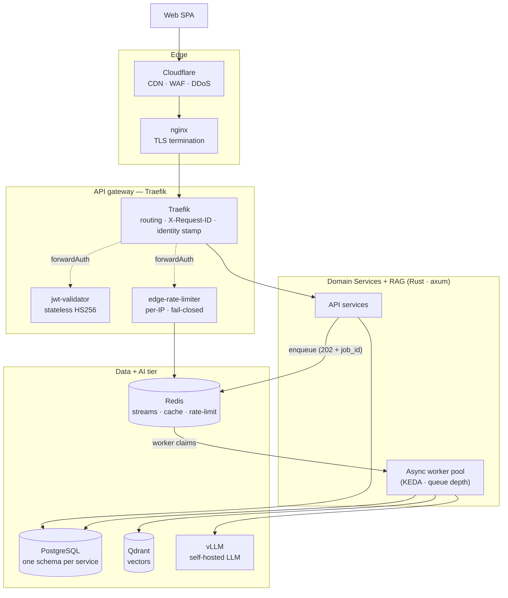

# System Overview

The shape of Saturn as it runs today: what's in front of the services, what the
services are, how data moves, and why the AI path is the thing that scales.

## Layers (top → bottom)

1. **Clients** — a web SPA (React/Vite), and a staff admin UI in the same SPA.
2. **Edge** — a commercial CDN/WAF (DDoS/edge filtering) → `nginx` for TLS termination →
   the API gateway.
3. **API gateway** — **Traefik**. Routes by path prefix, validates JWTs *statelessly*
   (a small `jwt-validator` service it calls via `forwardAuth`), enforces per-IP rate
   limits on the auth surface (an `edge-rate-limiter` service), and stamps the
   validated identity onto the backend request after a strip-middleware blanks any
   client-supplied identity first. Injects `X-Request-ID` for tracing.
4. **Services** — eight domain microservices, plus the two gateway-side services above.
5. **Data & external** — PostgreSQL, Redis, Qdrant, and the self-hosted LLM.
6. **Cross-cutting** — observability (Prometheus, Grafana, Loki, Jaeger, OpenTelemetry,
   Grafana Alloy) and **KEDA** queue-depth autoscaling.



## The services

Ten services in all: **eight domain services** and **two that live at the gateway**.

The domain services are split along **bounded contexts**, not by technology: identity and
the token; the **AI assistant path** (the async RAG Q&A engine, the local embedding
model, and per-user history); and the rest of the product's content/learning domain.
Each service is its own process that owns its own Postgres schema and its own
least-priv database role, so a compromise in one service cannot reach another's tables.
The services that do heavy or batch work run a **dedicated worker** on a durable queue
instead of doing it in the request path, and the embedding model is internal-only —
never exposed at the edge. The **AI assistant path** is the compute hot spot and the
scaling target (the next section is all about it).

The two gateway-side services are called by **Traefik, not by clients**: a **stateless
token validator** (so the gateway can authorize without a per-request hop back to
identity) and a **per-IP edge rate limiter** that fails closed. Both are introduced in
the Layers above and detailed in `auth-and-security.md`.

> The service names and boundaries here are **genericized** — what matters
> architecturally is the split: one service per bounded context, each owning one schema
> and one role, with heavy work pushed onto dedicated workers.

## The primary scaling path — the async AI endpoint

The **Assistant** service is the only path with a per-request LLM call, so it is
**asynchronous** and the thing KEDA scales:

```
client ──POST /api/questions──►  202 Accepted + job_id   (returns immediately)
client ──GET  /api/questions/{job_id}/status──►  pending | processing | completed(answer) | failed

worker pool (KEDA 1→N on job-queue lag) claims a job, then:
   embed(question) ─► Qdrant search (fail-open) ─► fetch user prefs (fail-open)
   ─► LLM with context (vLLM) ─► save answer + persist history + emit a domain event
```

- **202 + poll**, not server-sent streaming to the client, so the connection doesn't
  hold an LLM-bound request open and the worker pool can scale on *queue depth* rather
  than *open connections*.
- **"Fail-open"** on the retrieval legs: if the embedding or vector lookup is
  unavailable, the worker falls back to a no-context LLM call rather than failing the
  question. A RAG dependency hiccup degrades answer quality; it never takes the endpoint
  down.
- **Cost caps** on every LLM call (`max_tokens`) plus a per-user daily budget and a
  global fleet ceiling (see `auth-and-security.md`). The async design is what makes those
  caps the real brake instead of a polite suggestion.

## Data architecture

- **PostgreSQL — one schema per service.** A single instance (plus a read replica, fronted
  by PgBouncer) hosts six schemas, one per owning service. Every service connects as its
  **own least-priv role** granted only on its own schema, so a compromised service can
  touch only its own tables. Migrations run as a single versioned `migrate` Job — the one
  component that holds the superuser.
- **Redis — four jobs.** (1) the **event bus** (streams with consumer groups), (2) the
  **job queue** for the async worker, (3) **rate limiting** (fixed-window counters), and
  (4) general **cache / sorted sets**. It is deliberately the *single* most important
  stateful dependency, so it runs AOF + noeviction (see availability in
  `auth-and-security.md`).
- **Qdrant — vectors.** Two collections: the RAG corpus (owned by the ingestion service) and per-user
  chat history (owned by the Assistant). Both are written/read fail-open.

## Inter-service communication

- **Sync, in-request:** ordinary HTTP (REST) between services and to the embedding
  endpoint. A small gRPC surface exists for the auth token check as a fallback path.
- **Async, across requests:** **Redis Streams** — a domain **event bus** (`…events`) with
  consumer groups for cross-service effects, plus the **job queue** for the async worker
  (see `event-bus.md`).
- The rule of thumb: **if it's needed for this response, call it; if it's a consequence
  of a state change, emit an event and let a consumer apply it.**

## Scaling strategy

- **KEDA** scales the Assistant worker pool **on job-queue lag** (1→5) and the ingestion
  worker on its pending queue (1→8) — i.e. on *work in the queue*, not on CPU, which is
  the honest signal for an async worker pool. See `../decisions/` (queue-depth
  autoscaling).
- Everything else runs at one replica; this is a single-node self-hosted cluster, so
  availability is bought with *process-level* resilience (probes, self-healing consumer
  groups, fail-open paths, off-box backups) rather than multi-replica HA.

## How it got here (strangler-fig)

The system began as one FastAPI app. Rather than a big-bang rewrite, I moved capability
to a new Rust service, put it behind the gateway, cut that traffic over, and left the
monolith serving the rest — repeating until the monolith had nothing left. That let every
service go live independently, with the old app as a fallback at each step. See
`../decisions/` (strangler-fig migration) for the tradeoffs.
